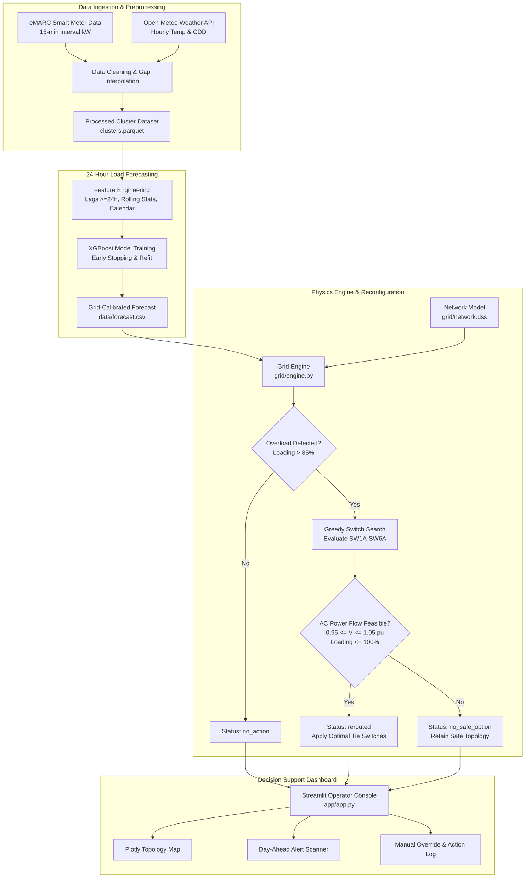

# ⚡ AI-Driven Load Forecasting & Dynamic Feeder Rerouting

[](https://www.python.org/)
[](https://www.epri.com/pages/sa/opendss)
[](https://xgboost.readthedocs.io/)
[](https://streamlit.io/)
[](https://plotly.com/)
[](LICENSE)

> **Final Year Engineering Capstone Project**  
> An autonomous cyber-physical energy management platform that combines **24-hour-ahead machine learning load forecasting** with **real-time physics-constrained power flow optimization** to proactively detect and mitigate transformer overloads through **dynamic low-voltage (LV) feeder reconfiguration**. (The network also models a normally open medium-voltage tie, `TIE1`; the rerouting engine does not switch it yet.)

---

## 📌 Table of Contents
- [Project Overview](#-project-overview)
- [Key Features](#-key-features)
- [System Architecture](#-system-architecture)
- [Distribution Network & Switching Topology](#-distribution-network--switching-topology)
- [Machine Learning Load Forecasting](#-machine-learning-load-forecasting)
- [Physics-Constrained Rerouting Engine](#-physics-constrained-rerouting-engine)
- [Stress Scenarios & Experimental Results](#-stress-scenarios--experimental-results)
- [Operator Dashboard (Streamlit & Plotly)](#-operator-dashboard-streamlit--plotly)
- [Repository Structure](#-repository-structure)
- [Getting Started & Installation](#-getting-started--installation)
- [Usage Guide & CLI Commands](#-usage-guide--cli-commands)
- [API & Interface Contract](#-api--interface-contract)
- [Future Enhancements](#-future-enhancements)
- [License](#-license)

---

## 📖 Project Overview

Modern electrical distribution grids are facing unprecedented stress caused by:
1. High-power **Electric Vehicle (EV)** charging sessions during evening peak hours.
2. Extreme weather events (such as **heatwaves**) triggering concentrated air-conditioning loads.
3. Rapid residential and commercial load growth that exceeds local substation transformer ratings.

Conventional utility solutions rely on expensive capital infrastructure upgrades (replacing transformers and underground cables) or crude load shedding (rolling blackouts). 

**Our Solution:**  
This project presents an intelligent, automated alternative: **Dynamic Feeder Rerouting**. By utilizing smart-meter telemetry and weather data, an **XGBoost Regressor** predicts distribution transformer loads 24 hours in advance. When an impending overload is detected (exceeding 85% of rated capacity), a **greedy constraint-satisfaction optimization engine** interfaced with **EPRI OpenDSS** calculates optimal tie-switch operations to reroute movable load blocks to adjacent, under-utilized transformers. The reconfiguration executes in **sub-10 milliseconds**, strictly enforcing ANSI voltage tolerances and thermal ampacity limits.

---

## ✨ Key Features

- **🧠 Day-Ahead Load Forecasting:**
  - 24-hour direct multi-step hourly demand forecasting using real smart-meter telemetry.
  - Single unified XGBoost model serving all transformers via train-mean scaling.
  - Engineered lag series ($\ge 24\text{ h}$ to prevent data leakage), rolling statistics, and cooling degree days (CDD).
  - Outperforms persistence baselines by over **21% in nRMSE** (achieving **25.3% nRMSE** at transformer level and **10.8%** for the sum of all six transformers).

- **⚡ Physics-Based Power Flow Emulation (OpenDSS):**
  - Full AC distribution power flow simulation using `opendssdirect.py`.
  - Realistic 11 kV dual-feeder topology with 6 distribution transformers (500 kVA each) and ANSI C84.1 voltage regulation ($0.95 \le V \le 1.05\text{ pu}$).
  - Split-load architecture: 80% non-transferable baseline load (Block A) and 20% transferable load (Block B).

- **🔄 Fast Greedy Rerouting Algorithm:**
  - Multi-round heuristic search for single-switch load transfers with automatic pairwise fallback.
  - Sub-second deterministic decision-making: average execution time of **5–9 ms** (maximum $<25\text{ ms}$).
  - Thermal and voltage safety checks on every candidate move; radial by construction (each move opens the block's home switch before closing its alternate, so no loop can form).
  - Failsafe handling: returns `no_safe_option` when grid capacity is mathematically exhausted, avoiding hazardous or unfeasible operations.

- **📊 Interactive Streamlit Operator Dashboard:**
  - Live interactive single-line network diagram powered by Plotly with real-time status color coding (green/amber/red).
  - Time-scrubbing replay slider with automatic "Jump to Peak Hour" capability.
  - Automated 24-hour day-ahead overload scanning matrix with severity tagging (`CRITICAL` vs `WARNING`).
  - One-click automated dispatch, manual switch overrides, and side-by-side before/after loading analytics.
  - Thread-isolated worker thread architecture preventing C-extension race conditions.

- **🔬 Comprehensive Scenario Verification:**
  - Validated across **1,073 continuous test hours** across 5 distinct operational scenarios: Normal Day, Feeder A Heatwave, EV Evening Surge, Severe Multi-Feeder Stress, and Extreme Single-Transformer Overload.

---

## 🏗 System Architecture



---

## 🔌 Distribution Network & Switching Topology

The electrical network represents an urban 11 kV / 0.415 kV distribution system with two radial feeders originating from a central 33/11 kV substation (`SUB`):

```
       +------------------- 11 kV Substation (SUB) -------------------+
       |                                                               |
  [Feeder A]                                                      [Feeder B]
       |                                                               |
    (Line A1)                                                       (Line B1)
       |                                                               |
      [A1] -------- Transformer T1 (500 kVA)                          [B1] -------- Transformer T4 (500 kVA)
       |            L1 (Block 1a: 80%)                              |            L4 (Block 4a: 80%)
       |            L1b (Block 1b: 20%) --[SW1A]--> (to L2)          |            L4b (Block 4b: 20%) --[SW4A]--> (to L5)
    (Line A2)                                                       (Line B2)
       |                                                               |
      [A2] -------- Transformer T2 (500 kVA)                          [B2] -------- Transformer T5 (500 kVA)
       |            L2 (Block 2a: 80%)                              |            L5 (Block 5a: 80%)
       |            L2b (Block 2b: 20%) --[SW2A]--> (to L3)          |            L5b (Block 5b: 20%) --[SW5A]--> (to L6)
    (Line A3)                                                       (Line B3)
       |                                                               |
      [A3] -------- Transformer T3 (500 kVA)                          [B3] -------- Transformer T6 (500 kVA)
       |            L3 (Block 3a: 80%)                              |            L6 (Block 6a: 80%)
       |            L3b (Block 3b: 20%) --[SW3A]--> (to L6) *        |            L6b (Block 6b: 20%) --[SW6A]--> (to L3) *
       |                                                               |
       +---------------- [TIE1: Normally Open MV Tie] -----------------+
       * Note: SW3A and SW6A provide inter-feeder cross-routing between Feeder A and Feeder B!
```

### Switching Matrix & Movable Blocks
Each transformer serves two distinct load components:
- **Block $a$ (80%):** Static, non-switchable critical base load connected to LV bus `Lx`.
- **Block $b$ (20%):** Transferable load block on auxiliary bus `Lxb`.

| Transformer | Rated Capacity | Base Bus | Movable Bus | Home Switch (Closed) | Alt Switch (Open) | Target Neighbor | Route Type |
|:-----------:|:--------------:|:--------:|:-----------:|:--------------------:|:-----------------:|:---------------:|:----------:|
| **T1** | 500 kVA | `L1` | `L1b` | `SW1H` | `SW1A` | **T2** | Intra-Feeder |
| **T2** | 500 kVA | `L2` | `L2b` | `SW2H` | `SW2A` | **T3** | Intra-Feeder |
| **T3** | 500 kVA | `L3` | `L3b` | `SW3H` | `SW3A` | **T6** | **Inter-Feeder** |
| **T4** | 500 kVA | `L4` | `L4b` | `SW4H` | `SW4A` | **T5** | Intra-Feeder |
| **T5** | 500 kVA | `L5` | `L5b` | `SW5H` | `SW5A` | **T6** | Intra-Feeder |
| **T6** | 500 kVA | `L6` | `L6b` | `SW6H` | `SW6A` | **T3** | **Inter-Feeder** |

---

## 📈 Machine Learning Load Forecasting

### 1. Dataset & Weather Calibration
- **Smart Meter Telemetry:** Prayas Energy Group **eMARC** (Electricity Monitoring Analysis and Reporting for Consumers) dataset comprising 15-minute resolution load blocks from June 1, 2019 to March 24, 2020 (filtered before COVID lockdowns).
- **Geographic Representation:** Consumer clusters mapped to regional distribution nodes in **Pune City** (T1, T2), **Pune** (T3), **Aurangabad** (T4), **Kanpur Rural** (T5), and **Gonda** (T6).
- **Weather Telemetry:** Real-time synchronized hourly 2-meter air temperature and calculated Cooling Degree Days ($\text{CDD} = \max(0, T - 22^\circ\text{C})$) retrieved from the Open-Meteo Historical Archive API.

### 2. Feature Matrix (Strict 24-Hour Horizon)
To ensure zero lookahead bias and emulate real-world Day-Ahead scheduling, all features for target hour $t$ strictly use information available at $t - 24\text{ h}$:
- **Calendar:** `hour` ($0\dots23$), `dow` ($0\dots6$), `is_weekend` (binary flag).
- **Lags:** `lag_24` (same hour yesterday), `lag_48` (two days prior), `lag_168` (same hour last week).
- **Rolling Aggregations:** `roll_mean_3`, `roll_mean_24`, `roll_mean_168`, `roll_max_24`.
- **Weather Covariates:** Forecasted temperature `temp`, `temp_lag_24`, and cooling demand `cdd`.
- **Transformer Embedding:** Categorical identifier mapped with mean-load normalization.

### 3. Model Benchmark & Test Accuracy
Evaluated over 1,073 continuous held-out test hours:

| Transformer | Model / Baseline | MAE (kW) | RMSE (kW) | nRMSE (%) | MAPE (%) |
|:-----------:|:-----------------|:--------:|:---------:|:---------:|:--------:|
| **T1** | **XGBoost (Refit)** | **0.42** | **0.61** | **19.99%** | **13.33%** |
| T1 | Same hour yesterday | 0.54 | 0.82 | 27.04% | 16.66% |
| T1 | Same hour last week | 0.53 | 0.76 | 24.88% | 16.84% |
| **T2** | **XGBoost (Refit)** | **0.43** | **0.60** | **20.98%** | **15.03%** |
| T2 | Same hour yesterday | 0.53 | 0.79 | 27.51% | 18.01% |
| **T3** | **XGBoost (Refit)** | **0.47** | **0.64** | **18.53%** | **14.18%** |
| T3 | Same hour yesterday | 0.56 | 0.79 | 22.99% | 16.63% |
| **T4** | **XGBoost (Refit)** | **0.69** | **0.90** | **28.66%** | **27.49%** |
| T4 | Same hour yesterday | 0.88 | 1.18 | 37.52% | 33.69% |
| **T5** | **XGBoost (Refit)** | **0.25** | **0.32** | **31.26%** | **35.52%** |
| T5 | Same hour yesterday | 0.27 | 0.36 | 34.85% | 33.43% |
| **T6** | **XGBoost (Refit)** | **0.63** | **0.85** | **32.95%** | **37.71%** |
| T6 | Same hour yesterday | 0.75 | 1.01 | 39.44% | 40.71% |
| **ALL (Pooled)** | **XGBoost (Refit)** | **0.48** | **0.68** | **25.33%** | **22.59%** |
| ALL (Pooled) | Same hour yesterday | 0.59 | 0.86 | 32.18% | 25.83% |
| ALL (Pooled) | Same hour last week | 0.64 | 0.90 | 33.43% | 28.54% |

MAE and RMSE are in raw cluster kW (the households' measured demand, before scaling to the 500 kVA grid model), which is why they are small. nRMSE and MAPE are scale-free.

> **Aggregation Effect:** When forecasting the total demand of all six transformers, individual consumer volatility smooths out significantly: XGBoost's **nRMSE drops from 25.4% (average per transformer) to 10.8%** for the sum. The persistence baseline shows the same effect (31.6% to 14.1%), so the aggregate is easier to forecast for any method.

---

## ⚙️ Physics-Constrained Rerouting Engine

The rerouting engine (`grid/engine.py`) optimizes network switch configurations under strict physical power flow constraints solved via EPRI OpenDSS.

### Mathematical Formulation
$$\min_{\mathbf{s} \in \mathcal{S}} \max_{i \in \{1,\dots,6\}} \left( \frac{S_{T_i}(\mathbf{s})}{S_{T_i}^{\text{rated}}} \right)$$

Subject to:
1. **Power Flow Solvability:** $\mathbf{f}(\mathbf{V}, \boldsymbol{\theta}, \mathbf{P}, \mathbf{Q}) = 0$ (AC power flow converges).
2. **Voltage Tolerances:** $0.95\text{ pu} \le |V_b| \le 1.05\text{ pu} \quad \forall b \in \mathcal{B}_{\text{MV}} \cup \mathcal{B}_{\text{LV}}$.
3. **Transformer Thermal Capacity:** $S_{T_i} \le 100\% \times S_{T_i}^{\text{rated}} \quad (500\text{ kVA})$.
4. **Feeder Line Ampacity:** $I_l \le I_l^{\text{rated}} \quad (220\text{ A})$.
5. **Radiality & Safety:** Break-before-make switching without closed loops or backfeeding.

### Algorithm Flow
1. **Evaluate Baseline:** Set forecasted/active loads. Solve AC power flow. If all transformers $\le 85\%$ threshold, return `status: no_action`.
2. **Identify Bottlenecks:** Isolate overloaded transformers.
3. **Round 1 (Greedy Search):** Test each admissible single move $t \in \text{free}$. Simulate in OpenDSS, verify voltage and thermal bounds. Select move yielding the largest reduction in peak loading.
4. **Round 2 (Pairwise Fallback):** If no single move achieves the $85\%$ target or improves the objective by $\ge 0.05\%$, test all valid switch pairs $(a, b)$.
5. **Convergence or Reversion:** If maximum loading $\le 85\%$, apply switches and return `status: rerouted`. If the grid cannot physically accommodate the overload safely, revert all switches to default and return `status: no_safe_option` along with the best partial configuration.

---

## 🧪 Stress Scenarios & Experimental Results

The platform was subjected to extensive validation over **1,073 continuous test hours** across 5 grid operating regimes:

| Scenario | Description | Overload Hours | Total Tx Hours Over | Successfully Rerouted | No Safe Option | Resolution Rate (%) | Mean Peak Before (%) | Mean Peak After (%) | Mean Decision Latency |
|:---|:---|:---:|:---:|:---:|:---:|:---:|:---:|:---:|:---:|
| **S1 Normal Day** | Unperturbed test period demand | 0 | 0 | 0 | 0 | n/a (no overloads) | — ¹ | — ¹ | 7.0 ms |
| **S2 Heatwave** | Feeder A (T1–T3) scaled by $\times 1.6$ | 5 | 5 | 5 | 0 | **100.0%** | 87.4% | 74.5% | 6.0 ms |
| **S3 EV Evening Surge** | T4 $+200\text{ kW}$ between 18:00–22:00 | 23 | 22 | 23 | 0 | **100.0%** | 87.3% | 69.5% | 5.0 ms |
| **S4 Severe Stress** | System-wide surge (all transformers $\times 2.5$) | 431 | 974 | 151 | 280 | **35.0%** | 105.5% | 79.7% | 7.0 ms |
| **S5 Edge Case** | Catastrophic localized spike (T3 $\times 4.0$) | 882 | 879 | 388 | 494 | **44.0%** | 118.0% | 75.4% | 9.0 ms |

¹ The peak columns average over overload hours only, and S1 has none. Across all S1 hours the highest transformer loading averages 32.7% (maximum 56.3%). Decision latency is machine-dependent; the figures above are from the original development laptop.

### Worst-Hour Stress Analysis

| Scenario | Worst Timestamp | Engine Status | Peak Before (%) | Peak After (%) | Min Voltage Before (pu) | Min Voltage After (pu) |
|:---|:---:|:---:|:---:|:---:|:---:|:---:|
| **S2 Heatwave** | 12 Mar 08:00 | `rerouted` | 88.6% | **79.6%** | 0.9936 pu | 0.9936 pu |
| **S3 EV Surge** | 29 Feb 21:00 | `rerouted` | 91.5% | **72.9%** | 0.9958 pu | 0.9958 pu |
| **S4 Severe Stress** | 21 Feb 06:00 | `no_safe_option` | 143.8% | 143.8% | 0.9907 pu | 0.9907 pu |
| **S5 Edge Case** | 17 Feb 07:00 | `no_safe_option` | 200.6% | 200.6% | 0.9891 pu | 0.9891 pu |

> **Key Finding:** In realistic high-stress scenarios (S2 heatwave and S3 EV charging surges), the engine achieved a **100% resolution rate**, eliminating all transformer overloads and bringing peak utilization well below the 85% safety boundary without causing any voltage drops.

---

## 🖥 Operator Dashboard (Streamlit & Plotly)

The project includes an operator-grade web console built with **Streamlit** and **Plotly**:

1. **Top KPI Ribbon:** Displays current overloaded transformer count, system-wide peak loading percentage, minimum bus voltage (pu), and model forecast nRMSE.
2. **Interactive Topology Visualizer:**
   - Color-coded transformers: **Green** ($<70\%$), **Amber** ($70\%\dots85\%$), **Red** ($>85\%$).
   - Dotted grey lines indicate normally open tie switches.
   - Highlighting orange paths indicate closed tie connections with transferred load blocks.
3. **Load Forecasting Horizon Plot:**
   - 72-hour sliding window with actual demand, forecasted demand, and scenario multipliers.
   - Dynamic threshold line indicating rated thermal limit.
4. **Day-Ahead Overload Scanning Matrix:**
   - Proactively evaluates all 24 hours of the current day.
   - Generates an actionable table highlighting which transformer will overload first, number of hours at risk, and projected peak severity.
5. **Operator Control Deck:**
   - Primary **"Reroute"** trigger executing automated dispatch.
   - **"Reset Switches"** button restoring baseline topology.
   - Manual switch override multi-select for authorized dispatchers.
   - Before/after comparative bar chart and execution audit trail log.

---

## 📂 Repository Structure

```
Load-Forecasting-Dynamic-Feeder-routing/
├── README.md                      # Primary project documentation (this file)
├── LICENSE                        # MIT licence
├── requirements.txt               # Dependency ranges the code works with
├── requirements-lock.txt          # Exact versions that reproduced docs/results.csv and docs/metrics.csv
└── project/
    ├── app/                       # Streamlit web application & visualization
    │   ├── app.py                 # Main operator dashboard entry point
    │   └── plots.py               # Plotly network topology & load curve renderers
    ├── grid/                      # Power systems simulation & reconfiguration
    │   ├── engine.py              # Heuristic greedy rerouting engine & OpenDSS API
    │   ├── network.dss            # OpenDSS circuit definition (11 kV dual-feeder)
    │   ├── scenarios.py           # S1-S5 scenario definitions & test runner
    │   ├── test_day1.py           # Basic power flow & manual switch test script
    │   └── run_results.py         # Full 1,073-hour simulation benchmark script
    ├── ml/                        # Machine learning forecasting pipeline
    │   ├── prepare_data.py        # Smart meter extraction & weather synchronization
    │   ├── features.py            # Feature engineering (lags, rolling stats, CDD)
    │   ├── train_xgb.py           # XGBoost training with early stopping & refit
    │   ├── evaluate.py            # Accuracy benchmarking vs persistence models
    │   └── model_xgb.json         # Serialized production XGBoost model
    ├── data/                      # Data assets & outputs
    │   ├── raw/                   # eMARC Excel/CSV files & weather cache
    │   ├── processed/             # Cleaned clusters.parquet
    │   ├── forecast.csv           # Final held-out test predictions (interface contract)
    │   ├── forecast_all.csv       # Complete train/val/test predictions
    │   └── scale_factors.json     # Normalization & grid scaling parameters
    ├── docs/                      # Documentation artifacts & figures
    │   ├── metrics.csv            # Comprehensive model accuracy metrics
    │   ├── results.csv            # S1-S5 scenario summary over 1,073 hours
    │   ├── results_worst_hour.csv # Worst-hour peak reduction analysis
    │   └── fig_actual_vs_pred.png # Actual vs predicted multi-transformer plot
    ├── tests/                     # Automated pytest suite (see "Running the tests")
    │   ├── test_network.py        # Network structure, default switch state, operating point
    │   ├── test_engine.py         # Rerouting outcomes, safety limits, switch restoration
    │   ├── test_features.py       # No-leakage checks for the 24 h-ahead features
    │   ├── test_artifacts.py      # Forecast files, scale factors and model agree
    │   └── test_golden_results.py # Reproduces docs/results.csv and docs/metrics.csv exactly
    ├── pytest.ini                 # Test configuration
    ├── check_imports.py           # Environment sanity verification script
    └── smoke_test.py              # OpenDSS direct solver smoke test
```

> `data/raw/` and `data/processed/` are not in the repository (they are gitignored). The eMARC smart-meter files must be obtained from Prayas Energy Group and placed in `data/raw/` before `ml/prepare_data.py` and `ml/train_xgb.py` can be re-run. Everything else (dashboard, grid benchmark, evaluation, tests) runs from the committed forecast files.
>
> If OpenDSS crashes the dashboard process, `app/app.py` writes `dss_crash.log` in `project/`. It is machine-specific and gitignored.

---

## 🚀 Getting Started & Installation

### Prerequisites
- **Python:** Version `3.10` or higher recommended.
- **Operating System:** Windows, Linux, or macOS.

### 1. Clone the Repository
```bash
git clone https://github.com/PrithviKoruche-dev/Load-Forecasting-Dynamic-Feeder-routing.git
cd "Load-Forecasting-Dynamic-Feeder-routing"
```

### 2. Create and Activate Virtual Environment
```bash
# Windows (PowerShell)
python -m venv .venv
.venv\Scripts\Activate.ps1

# Linux / macOS
python3 -m venv .venv
source .venv/bin/activate
```

### 3. Install Dependencies
```bash
pip install --upgrade pip
pip install -r requirements.txt
```
To reproduce the published numbers with exactly the versions used to verify them, install `requirements-lock.txt` instead.

### 4. Verify System Installation
Run the sanity checks to verify OpenDSS and ML library bindings:
```bash
python project/check_imports.py
python project/smoke_test.py
```
*Expected output: All packages print `OK`, and OpenDSS reports `converged: True`.*

---

## 💻 Usage Guide & CLI Commands

### 1. Launch the Operator Dashboard
Launch the interactive web application:
```bash
streamlit run project/app/app.py
```
Open your browser at `http://localhost:8501`.

### 2. Run the Switching Engine & Stress Scenarios
Test the heuristic rerouting algorithm against scenarios S1–S5:
```bash
cd project/grid
python scenarios.py
```

### 3. Run the Full 1,073-Hour Benchmark
Execute the complete test-period evaluation across all scenarios and generate report CSVs:
```bash
cd project/grid
python run_results.py
```

### 4. Re-train the Machine Learning Model
Requires the eMARC raw files in `project/data/raw/` (see the note under Repository Structure). Re-run data preparation, feature engineering, training, and model export:
```bash
cd project/ml
python prepare_data.py
python train_xgb.py
python evaluate.py
```

### 5. Running the Tests
```bash
cd project
pytest                  # full suite, about 30 s (includes the 1,073-hour benchmark)
pytest -m "not slow"    # quick checks only, under 2 s
```
The golden tests re-run the scenario benchmark and the forecast evaluation and compare them with `docs/results.csv`, `docs/results_worst_hour.csv` and `docs/metrics.csv` (timing columns excluded). If a change alters any published number, these tests fail.

---

## 📑 API & Interface Contract

### 1. Forecasting Data Contract (`data/forecast.csv`)
The ML forecasting pipeline exposes a simple CSV interface utilized by the grid simulator:
| Column Name | Data Type | Description |
|:---|:---:|:---|
| `timestamp` | `YYYY-MM-DD HH:MM:SS` | Hourly timestamp of target forecast |
| `transformer_id` | `string` (`T1` to `T6`) | Identifier of the distribution transformer |
| `predicted_kw` | `float` | 24-hour-ahead forecast in kW |
| `actual_kw` | `float` | Real ground-truth demand in kW |

### 2. Grid Engine API (`grid/engine.py`)
```python
def evaluate_and_reroute(loads_kw: dict, threshold: float = 85.0) -> dict:
    """
    Evaluates transformer loadings and computes optimal tie-switch actions.

    Parameters:
        loads_kw (dict): Active power per transformer, e.g. {"T1": 320.0, ..., "T6": 290.0}
        threshold (float): Loading % trigger limit (default: 85.0%)

    Returns:
        dict: {
            "status": "rerouted" | "no_action" | "no_safe_option",
            "action": list[str],          # e.g. ["move T1 block b -> T2"]
            "before": dict,               # max_loading, min_voltage_pu, max_line_loading
            "after": dict,                # post-switching metrics
            "log": list[str],             # step-by-step solver audit trail
            "overloaded": list[str],      # list of overloaded transformers
            "compute_s": float            # algorithm execution time in seconds
        }
    """
```

---

## 🔮 Future Enhancements

- [ ] **Multi-Period Lookahead Optimization:** Incorporate a receding-horizon Model Predictive Control (MPC) formulation to penalize excessive switch wear over 24 hours.
- [ ] **Distributed Energy Resources (DERs):** Integrate rooftop Solar PV arrays and Battery Energy Storage Systems (BESS) for localized peak shaving.
- [ ] **Reinforcement Learning (RL):** Benchmark deep Q-networks (DQN) or PPO agents against the greedy heuristic for complex meshed distribution grids.
- [ ] **IEC 61850 / DNP3 SCADA Integration:** Provide standardized protocol gateways for hardware-in-the-loop (HIL) testing with physical microgrid controllers.

---

## 📜 License

This project is licensed under the **MIT License** — see the [LICENSE](LICENSE) file for details.

---

<p align="center">
  <b>Final Year Engineering Project</b> • Department of Electrical / Computer Engineering<br>
  Developed with ❤️ using Python, OpenDSS, and Streamlit.
</p>